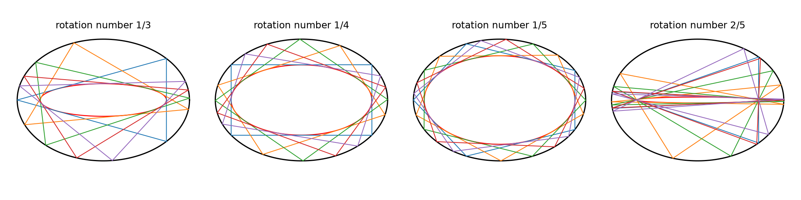

# Elliptic Billiards

A ball bouncing inside an ellipse never wanders freely: every segment of its
path stays tangent to the same confocal conic (the *caustic*). This project
proves that fact, checks it numerically with a simulator written from scratch,
and then asks what happens when the table is **no longer an ellipse**: how
quickly does the hidden order break down into chaos?

The starting point is a high-school problem: the ellipse x²/4 + y²/2 = 1 from
2025 Gaokao National Paper II, Q16.

## Research question

Deform the ellipse (superellipse |x/a|^p + |y/b|^p = 1, stadium, ...). How fast
does the quantity conserved in the elliptic case (d₁d₂, the product of the
focal distances to each segment) stop being conserved, and how does this
relate to Poincaré sections and Lyapunov exponents?

Related open problem: the **Birkhoff conjecture** (roughly: the ellipse is the
only integrable convex billiard table).

## Roadmap

- [x] Warm-up: next bounce point via Vieta's formulas ([notes/01-next-bounce.md](notes/01-next-bounce.md))
- [ ] Step 0: GeoGebra exploration, conjecture the caustic
- [x] Step 1: prove the caustic theorem, ellipse case ([notes/02-caustic-theorem.md](notes/02-caustic-theorem.md)); hyperbola case still open
- [x] Step 2: Python simulator ([billiards.py](billiards.py))
- [x] Step 3: verify d₁d₂ conservation ([notes/03-conserved-quantity.md](notes/03-conserved-quantity.md)), Poncelet porism, equal perimeters ([verify.py](verify.py))
- [ ] Step 4: deformed tables and the onset of chaos

## Running

    python3 -m venv .venv
    .venv/bin/pip install -r requirements.txt
    .venv/bin/python verify.py

## Results so far

On x²/4 + y²/2 = 1, over 2000 bounces d₁d₂ stays constant to about 1e-13, and
every segment is tangent to the predicted confocal conic to the same accuracy.
Periodic orbits close from every starting point (Poncelet porism), with equal
perimeters. For rotation number 1/4 the perimeter is 9.797958… = 4√6 = 4√(a²+b²),
the perimeter of the rhombus through the four vertices.

## Layout

- `notes/` — derivations and proofs
- `billiards.py` — the simulator
- `verify.py` — numerical checks, writes `figures/`
- `LOG.md` — work log, including what was done with tutor help
