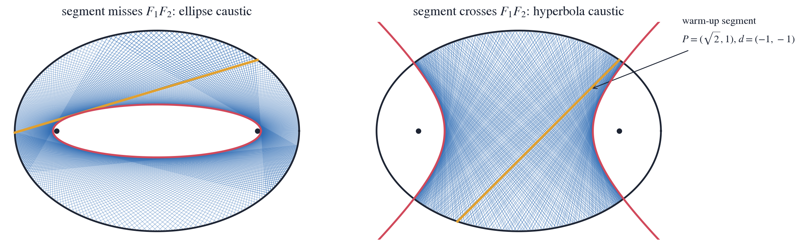
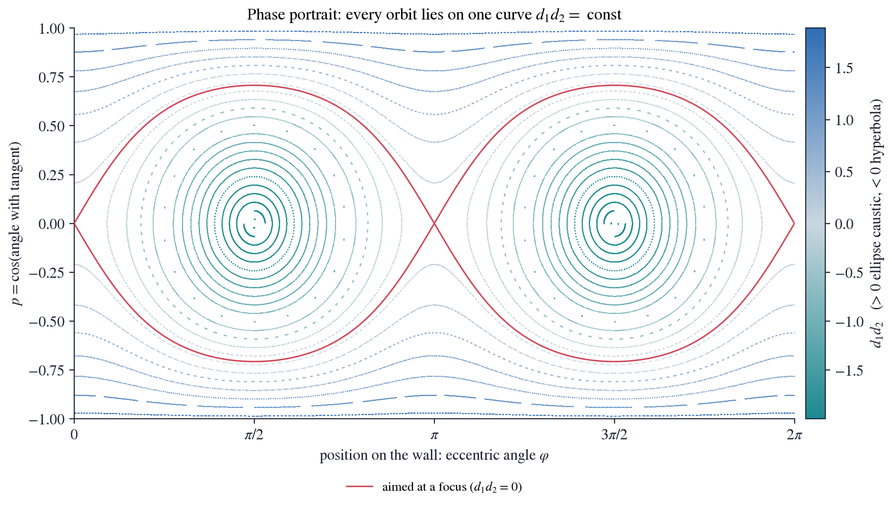
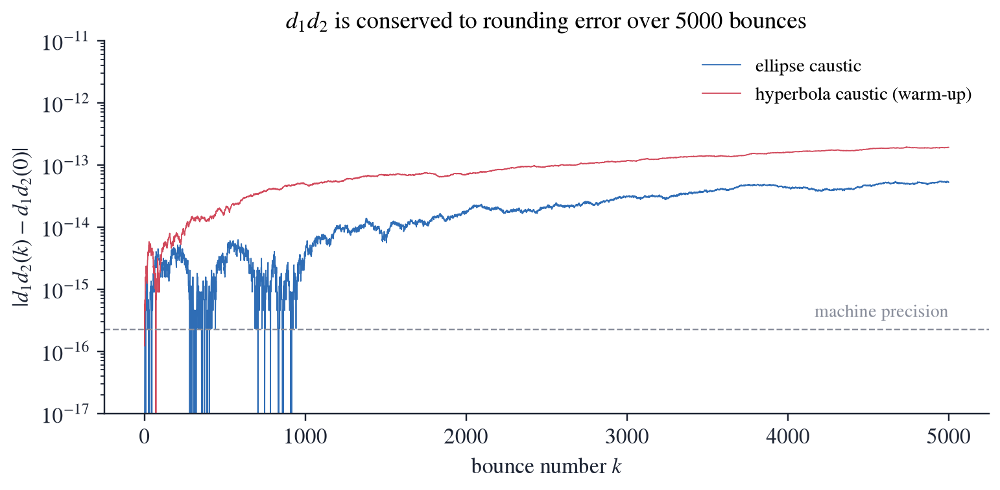

# Elliptic Billiards

**From a gaokao ellipse to the onset of chaos: how the caustics of elliptic billiards break.**

<p align="center"></p>

A ball bouncing inside an ellipse never wanders freely. Every segment of its
path is tangent to the same confocal conic, the **caustic**, and the product
$d_1d_2$ of the distances from the two foci to the path never changes. This
project proves these facts with high-school tools, checks them to machine
precision with a simulator built on Vieta's formulas, and then asks:

> **When the table is no longer an ellipse, how quickly does the hidden order
> break down into chaos?**

The starting point is the ellipse $x^2/4 + y^2/2 = 1$ from **2025 Gaokao
National Paper II, Q16**. The question sits next to a famous open problem, the
**Birkhoff conjecture**: the ellipse should be the only convex table whose
billiard is integrable.

## From the gaokao to the theorems

| Gaokao tool | What it becomes here | Where |
|---|---|---|
| 联立 + 韦达 (2025 National II Q16) | the next bounce point, $t^\ast = -B/A$ | [note 01](notes/01-next-bounce.md) |
| Optical property (2010 Anhui Q19), 将军饮马, SAS | the caustic theorem | [note 02](notes/02-caustic-theorem.md) |
| 二级结论 $d_1d_2 = b^2$ for tangent lines | a conserved quantity of the motion | [note 03](notes/03-conserved-quantity.md) |

<p align="center"></p>

## Results so far

Every claim in the notes is checked by `verify.py` (21 checks, all passing),
on $x^2/4 + y^2/2 = 1$:

| Check | max. error |
|---|---|
| Each step of the caustic proof, on 300 random orbits | $7\times10^{-14}$ |
| $d_1d_2$ constant over 5000 bounces (ellipse and hyperbola caustics) | $1.9\times10^{-13}$ |
| Every segment tangent to the predicted conic $\lambda = b^2 - d_1d_2$ | $1.9\times10^{-13}$ |
| Poncelet porism: closing from every start, rotation numbers 1/5, 1/4, 2/7, 1/3 | $2.2\times10^{-13}$ |
| Equal perimeters for each rotation number | $1.4\times10^{-13}$ |
| Rotation number 1/4: perimeter $= 4\sqrt{a^2+b^2} = 4\sqrt6$ | $2.5\times10^{-14}$ |

<p align="center"></p>

**Phase portrait.** Plot each bounce by its position on the wall and its
angle. Every orbit stays on a single curve, a level set of $d_1d_2$. The red
curves are orbits aimed at a focus. They separate the orbits with ellipse
caustics (top and bottom) from those with hyperbola caustics (the two islands).
Step 4 asks what happens to this picture when the table is deformed.

<p align="center"></p>

<p align="center"></p>

## Roadmap

- [x] Warm-up: the next bounce point via Vieta's formulas
- [x] Caustic theorem, ellipse case, with a complete elementary proof
- [x] Simulator and numerical verification
- [x] Paper draft: background and method ([paper/main.tex](paper/main.tex))
- [ ] Caustic theorem, hyperbola case; signed $d_1d_2 = b^2 - \lambda$
- [ ] GeoGebra exploration
- [ ] **Deformed tables and the onset of chaos (the original research)**

## Running

```bash
python3 -m venv .venv
.venv/bin/pip install -r requirements.txt
.venv/bin/python verify.py     # 21 pass/fail checks
.venv/bin/python figures.py    # regenerates figures/
```

The paper is in `paper/`. Compile it with `pdflatex` + `bibtex`, or upload
`paper/` and `figures/` to Overleaf.

## Layout

| Path | Contents |
|---|---|
| `notes/` | derivations and proofs, each starting from a gaokao problem |
| `billiards.py` | the simulator |
| `verify.py` | numerical checks of every claim in the notes |
| `figures.py` | makes every figure in `figures/` |
| `paper/` | LaTeX paper draft and bibliography |
| `LOG.md` | work log, including exactly what was drafted with AI help |
