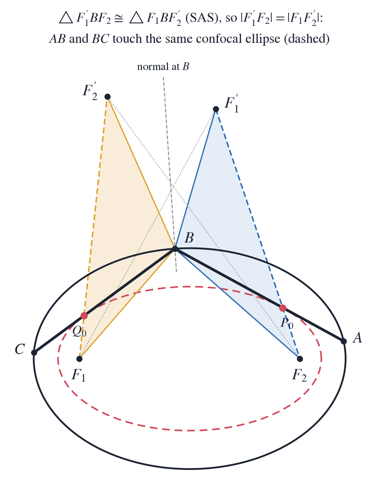

# 02 · The caustic theorem

> **Gaokao starting point.** Three tools you already know:
> the **optical property** of the ellipse (2010 Anhui Q19),
> **将军饮马** (shortest path via a reflection), and **congruent triangles (SAS)**.

$C$ is an ellipse with foci $F_1, F_2$. A ball moves inside $C$ and reflects off
the wall by the law of reflection. Call an orbit *non-focal* if no segment
passes through $F_1$ or $F_2$.

**Theorem.** Let $AB$ be a segment of a non-focal orbit.
1. If line $AB$ does not separate $F_1$ and $F_2$, then every segment of the
   orbit is tangent to the same ellipse with foci $F_1, F_2$.
2. If line $AB$ separates $F_1$ and $F_2$, then every segment is tangent to the
   same hyperbola with foci $F_1, F_2$.

This curve is the **caustic** of the orbit. Below we prove part 1. Part 2 is
left as an exercise.

<p align="center"></p>

---

## Tool 1 · The optical property (光学性质)

**Fact.** At every point $B \in C$, the normal line bisects $\angle F_1BF_2$.
Equivalently, the rays $BF_1$ and $BF_2$ are mirror images in the normal.

> **2010 Anhui Q19** (文/理 paper not confirmed). The ellipse through
> $A(2,3)$ with foci on the $x$-axis and $e = \tfrac12$ is
> $x^2/16 + y^2/12 = 1$, with $F_{1,2} = (\mp2, 0)$. The bisector of
> $\angle F_1AF_2$ is $2x - y - 1 = 0$.
>
> This is exactly the normal at $A$: the normal direction is
> $(x_0/a^2,\ y_0/b^2) = (\tfrac18, \tfrac14) \parallel (1,2)$, and the line through
> $(2,3)$ in direction $(1,2)$ is $2x - y - 1 = 0$. ✓

The law of reflection says the incoming and outgoing rays $BA$ and $BC$ are also
mirror images in the normal at $B$. So **the reflection $\sigma_B$ in the normal
at $B$ swaps $BA \leftrightarrow BC$ and $BF_1 \leftrightarrow BF_2$.**

## Tool 2 · 将军饮马 and tangency

**Lemma 1.** Let $\ell$ be a line with $F_1, F_2$ strictly on the same side, and
let $F_1'$ be the reflection of $F_1$ in $\ell$. Then the ellipse with foci
$F_1, F_2$ and major axis

```math
2a' = |F_1'F_2|
```

is tangent to $\ell$, and the point of tangency is $P_0 = F_1'F_2 \cap \ell$.

*Proof.* For $P \in \ell$ we have $|PF_1| = |PF_1'|$, so by the triangle inequality

```math
|PF_1| + |PF_2| = |PF_1'| + |PF_2| \;\ge\; |F_1'F_2| ,
```

with equality iff $P$ lies on segment $F_1'F_2$, i.e. $P = P_0$ (将军饮马).
So $P_0$ is on the ellipse $|PF_1| + |PF_2| = |F_1'F_2|$, and every other point of
$\ell$ is strictly outside it. A line that meets an ellipse in exactly one
point and otherwise stays outside is tangent to it. $\blacksquare$

**Lemma 2.** If $AB$ is a chord of $C$ satisfying Lemma 1, then $P_0$ lies
strictly between $A$ and $B$.

*Proof.* Take any point $X$ strictly between $A$ and $B$. It is inside $C$, so
$|XF_1| + |XF_2| < 2a$. Then $|P_0F_1| + |P_0F_2| \le |XF_1| + |XF_2| < 2a$, so $P_0$
is also inside $C$. The only points of line $AB$ inside $C$ are those strictly
between $A$ and $B$. $\blacksquare$

## Which side the foci are on is preserved

**Lemma 3.** Let $A, B, C$ be consecutive bounce points of a non-focal orbit.
Then line $AB$ separates $F_1, F_2$ if and only if line $BC$ does.

*Proof.* The foci are strictly inside $C$, so $\angle F_1BF_2$ lies in the open
half-plane on the inner side of the tangent at $B$. The ray from $B$ away from
$A$ points outside $C$, so it cannot enter this angle. Hence line $AB$ separates
$F_1, F_2$ iff the ray $BA$ lies strictly inside $\angle F_1BF_2$.

The mirror $\sigma_B$ maps $\angle F_1BF_2$ to itself (it swaps its two sides)
and maps ray $BA$ to ray $BC$. So $BA$ is inside the angle iff $BC$ is. $\blacksquare$

## Proof of the theorem, part 1

Let $A, B, C$ be consecutive bounce points, with line $AB$ not separating the
foci. By Lemma 3, line $BC$ doesn't either.

- Reflect $F_1$ in line $AB$ to get $F_1'$. By Lemma 1, the confocal ellipse
  tangent to $AB$ has $2a' = |F_1'F_2|$.
- Reflect $F_2$ in line $BC$ to get $F_2'$. By Lemma 1, the confocal ellipse
  tangent to $BC$ has $2a'' = |F_1F_2'|$.

We show $|F_1'F_2| = |F_1F_2'|$ by proving $\triangle F_1'BF_2 \cong \triangle F_1BF_2'$ (SAS).

1. $|BF_1'| = |BF_1|$, since $B$ is on the mirror line $AB$.
2. $|BF_2| = |BF_2'|$, since $B$ is on the mirror line $BC$.
3. **The included angles are equal.** $F_1'$ and $F_2$ lie on opposite sides of
   line $AB$, and by Lemma 2 segment $F_1'F_2$ crosses it at $P_0$ on ray $BA$.
   So ray $BA$ lies inside $\angle F_1'BF_2$, and, using $\angle F_1'BA = \angle ABF_1$ (mirror),

   ```math
   \angle F_1'BF_2 = \angle F_1'BA + \angle ABF_2 = \angle ABF_1 + \angle ABF_2 .
   ```

   In the same way, ray $BC$ lies inside $\angle F_1BF_2'$, and

   ```math
   \angle F_1BF_2' = \angle F_1BC + \angle CBF_2' = \angle CBF_1 + \angle CBF_2 .
   ```

   The mirror $\sigma_B$ preserves angles and swaps $BA \leftrightarrow BC$,
   $BF_1 \leftrightarrow BF_2$. So $\angle ABF_1 = \angle CBF_2$ and
   $\angle ABF_2 = \angle CBF_1$. The two sums are equal.

Therefore $|F_1'F_2| = |F_1F_2'|$, i.e. $a' = a''$. Two confocal ellipses with the
same major axis are the same ellipse, so $AB$ and $BC$ are tangent to the same
caustic. By induction along the orbit, all segments are. $\blacksquare$

*Numerical check.* On 764 random bounces of $x^2/4 + y^2/2 = 1$, Lemma 2, Lemma 3,
the angle identities and $|F_1'F_2| = |F_1F_2'|$ all hold, with largest error
$2.7\times10^{-15}$.

## Proof of the theorem, part 2 (hyperbola caustic)

**Lemma 1′.** Let $\ell$ be a line that separates $F_1, F_2$, passes through
neither, and does not pass through the centre $O$ (the midpoint of $F_1F_2$). Let $F_1'$ be the
reflection of $F_1$ in $\ell$. Then the hyperbola with foci $F_1, F_2$ and
real axis

```math
2a' = |F_1'F_2|
```

is tangent to $\ell$.

*Proof.* Now $F_1'$ and $F_2$ are on the same side of $\ell$. For $P \in \ell$,

```math
\bigl|\,|PF_1| - |PF_2|\,\bigr| = \bigl|\,|PF_1'| - |PF_2|\,\bigr| \;\le\; |F_1'F_2| ,
```

with equality iff $P$ is on line $F_1'F_2$ but not strictly between $F_1'$ and
$F_2$. Line $F_1'F_2$ is not parallel to $\ell$ (that happens exactly when $F_1, F_2$
are equidistant from $\ell$, i.e. when $\ell$ passes through $O$), so there is exactly one such point $P_0$. Every other
point of $\ell$ satisfies $\bigl||PF_1| - |PF_2|\bigr| < 2a'$, i.e. it lies
strictly between the two branches. A line that touches the hyperbola once and
otherwise stays between the branches is tangent to it.

Finally, $2a' < |F_1F_2|$, so this is a genuine hyperbola: by the triangle
inequality $\bigl||P_0F_1| - |P_0F_2|\bigr| \le |F_1F_2|$, with equality only on
line $F_1F_2$ outside the segment $F_1F_2$. But $\ell$ meets line $F_1F_2$
inside that segment. $\blacksquare$

*Proof of part 2.* Let $A, B, C$ be consecutive bounce points with line $AB$
separating the foci. By Lemma 3, so does $BC$. Define $F_1', F_2'$ as before.
By Lemma 1′ it suffices to show $|F_1'F_2| = |F_1F_2'|$, and again
$|BF_1'| = |BF_1|$, $|BF_2| = |BF_2'|$. This time $F_1'$ and $F_2$ are on the
**same** side of line $AB$, so the angle between them is a difference:

```math
\angle F_1'BF_2 = \bigl|\angle ABF_2 - \angle ABF_1\bigr|, \qquad
\angle F_1BF_2' = \bigl|\angle CBF_1 - \angle CBF_2\bigr| .
```

The mirror $\sigma_B$ gives $\angle ABF_1 = \angle CBF_2$ and
$\angle ABF_2 = \angle CBF_1$, so the angles are equal, and SAS finishes the
proof. $\blacksquare$

(A segment through $O$ is parallel to an asymptote of the confocal hyperbola:
it touches it "at infinity". The theorem still holds for such segments by
continuity, since $d_1d_2$ is conserved on all nearby orbits (note 03) and
depends continuously on the segment.)

*Numerical check.* On 510 random bounces with segments between the foci, the
angle identities and $|F_1'F_2| = |F_1F_2'|$ hold to $8\times10^{-14}$.

## To do myself

- [ ] Redraw the proof figure by hand or in GeoGebra.
- [ ] What happens to an orbit through a focus? (Optical property: next it
      passes through the other focus. Where does it end up after many bounces?)
